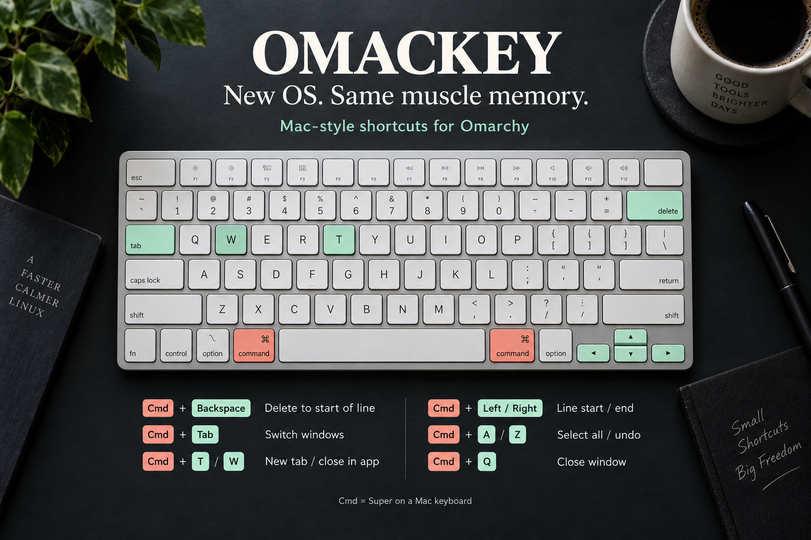

# Omackey: New OS. Same muscle memory.



You switch to Omarchy. Your hands don't get the memo.

You press Cmd+Backspace to delete to the start of a line. Cmd+T for a new tab. Cmd+W to close it. Then comes the tiny pause: *right, different machine.*

If you spend your day moving between a Mac and Omarchy, those pauses add up. If you've just moved from macOS, they're a familiar part of the adjustment.

I built **Omackey** to bring those habits with you.

It's an Omarchy plugin that adds Mac-style shortcuts and an optional, theme-aware window switcher. On a Mac keyboard, Cmd maps to the Super key used by Omarchy.

- **Cmd+Backspace:** delete to the start of the line.
- **Cmd+Left / Right:** jump to the start / end of the line.
- **Cmd+T / W:** new tab / close in the focused app.
- **Cmd+Shift+T:** reopen a closed tab.
- **Cmd+A / Z / F:** select all, undo, find.
- **Cmd+Tab:** move through windows; release Cmd to focus your selection.
- **Cmd+` (grave):** cycle through windows of the current application.

The switcher gives individual windows their own tiles, with titles and application icons—even when several belong to the same app. Hold Cmd, choose a window, release. Add Shift to cycle backwards.

There are a few deliberate details: Cmd+W sends Ctrl+W to the focused app, while Cmd+Q closes the focused window. Delete-to-start uses Ctrl+U in windows tagged as terminals, and Shift+Home followed by Backspace elsewhere. Application behavior depends on how it handles those keys.

### Try it

From your Omarchy session:

```bash
git clone https://github.com/asaharan/omackey.git
cd omackey
./install.sh
```

The installer adds the bindings and asks whether to enable the switcher UI. See the [README](../README.md) for controls and removal instructions.

**Your hands already learned these shortcuts. Let them keep using them.**

[Get Omackey on GitHub](https://github.com/asaharan/omackey)

Try it in your editor, browser, and terminal. If a shortcut behaves differently than expected, open an issue with the app, shortcut, and expected behavior. Which Mac habit should come next?

---

## Short social post

I switched to Omarchy. My hands stayed on macOS.

So I built Omackey: Cmd+Backspace to delete to line start, familiar tab shortcuts, and a window switcher.

New OS. Same muscle memory.

https://github.com/asaharan/omackey

*Attach `assets/omackey-muscle-memory-square.png`.*

## Community post title

I built Omackey to bring my Mac keyboard habits to Omarchy

## Release description

Omackey brings Mac-style keyboard shortcuts to Omarchy: delete to line start, line navigation, familiar application actions, and an optional theme-aware per-window switcher. Built for developers moving between macOS and Omarchy, or making the switch.

See the README for installation, the shortcut list, and application-specific behavior.
